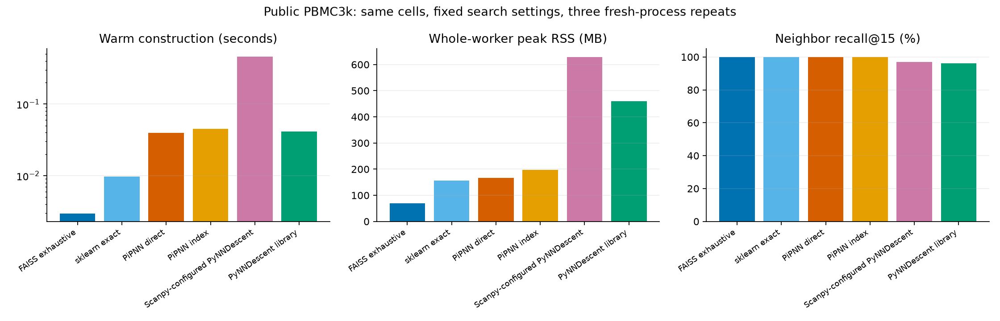
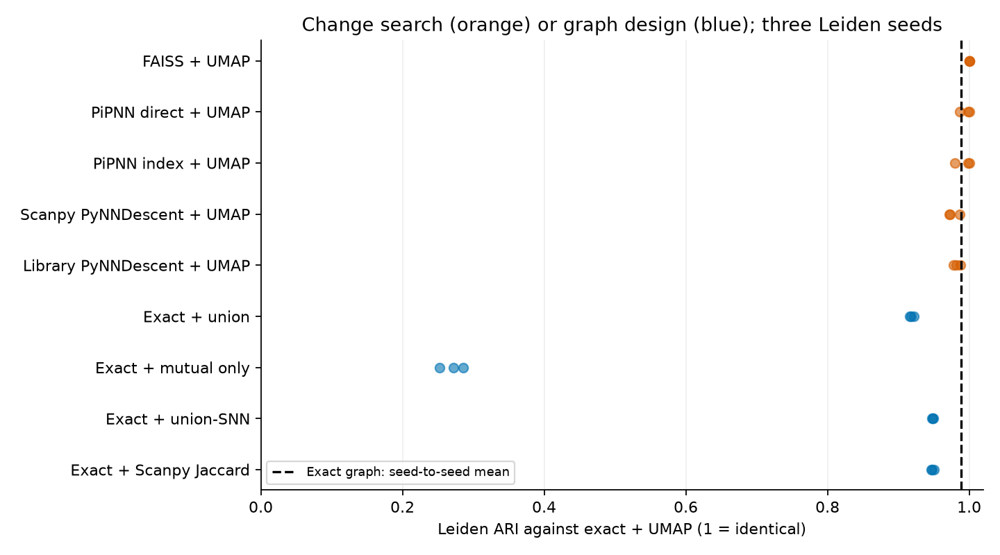

# Public PBMC3k: exact search and graph checks

All 2,638 cells and 50 stored PCs; Euclidean distance, self plus 15 other neighbors, four-thread settings. Three randomized serial measurements in fresh processes.

| Builder | Warm seconds, median | Peak process MB, median | Recall@15 |
|---|---:|---:|---:|
| FAISS exhaustive | 0.0030 | 68.7 | 100.0000% |
| sklearn exact | 0.0098 | 156.0 | 100.0000% |
| PiPNN direct | 0.0397 | 165.8 | 99.9823% |
| PiPNN index | 0.0451 | 197.4 | 99.9874% |
| Scanpy-configured PyNNDescent | 0.4595 | 628.9 | 97.0634% |
| PyNNDescent library | 0.0415 | 459.4 | 96.1612% |

Timing excludes imports, input loading and a method warmup. Peak RSS includes dependencies, input, warmup and construction. Common output normalization and evaluation are outside the timer; API output formats differ. This small example is not a large-data speed benchmark.

## Graphs and clustering

Orange changes search with fixed UMAP weighting. Blue changes graph design on fixed exact neighbors. Each point is one Leiden seed. This is a sensitivity check, not independent biological validation.

| Graph | Components | Isolated cells | Mean ARI to exact + UMAP |
|---|---:|---:|---:|
| sklearn_umap | 1 | 0 | 1.000000 |
| faiss_umap | 1 | 0 | 1.000000 |
| direct_umap | 1 | 0 | 0.995312 |
| index_umap | 1 | 0 | 0.992795 |
| scanpy_pynn_umap | 1 | 0 | 0.977084 |
| pynndescent_umap | 1 | 0 | 0.982550 |
| sklearn_union | 1 | 0 | 0.918638 |
| sklearn_mutual | 714 | 645 | 0.269846 |
| sklearn_snn | 1 | 0 | 0.948433 |
| sklearn_scanpy_jaccard | 1 | 0 | 0.948084 |

## Small groups

| Group | Cells | Builder | Recall@15 |
|---|---:|---|---:|
| Megakaryocytes | 15 | FAISS exhaustive | 100.0000% |
| Megakaryocytes | 15 | sklearn exact | 100.0000% |
| Megakaryocytes | 15 | PiPNN direct | 100.0000% |
| Megakaryocytes | 15 | PiPNN index | 100.0000% |
| Megakaryocytes | 15 | Scanpy-configured PyNNDescent | 96.8889% |
| Megakaryocytes | 15 | PyNNDescent library | 99.1111% |

## Precision and scope

FAISS/sklearn differing cells: 0. Every disagreement is audited with float64 exhaustive distances. The accuracy reference is sklearn.

Scanpy already chooses exact search automatically for a dataset this small. ANN controls force their respective backends. Selected distances are recomputed in float64 and cast to float32 before common UMAP weighting. Leiden uses resolution 1, two iterations, seeds 0/1/2. SNN symmetrization rules and the self-count convention are explained in docs/exact_graph_public.md. The original tutorial annotations are not an independent biological truth set.
